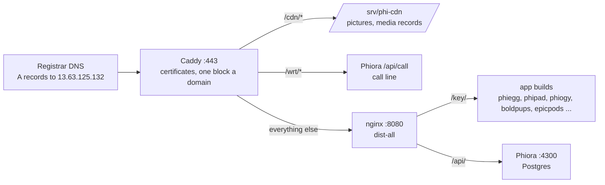

# Domains: what points where (27 November 2026)

Every domain is served by the one server, EC2 `13.63.125.132` (eu-north-1). Caddy on the host holds the
certificates and passes each request to nginx on `127.0.0.1:8080`, which serves every app's build at `/<key>/`
and Phiora at `/api/`. A domain is one Caddy site block that sends `/` to its app.
Nothing in this file has been changed on the server yet.



## 1. DNS records to enter at the registrar

Use TTL 300 while setting up, then raise it to 3600. There is no IPv6 address, so add no AAAA records.

| Domain | Type | Name (host) | Value | Notes |
|---|---|---|---|---|
| phipad.com | A | `@` | `13.63.125.132` | new; becomes Phipad's main address |
| phipad.com | CNAME | `www` | `phipad.com.` | |
| phiogy.com | A | `@` | `13.63.125.132` | new; the web Phiogy |
| phiogy.com | CNAME | `www` | `phiogy.com.` | |
| phiecs.com | A | `@` | `13.63.125.132` | new |
| phiecs.com | CNAME | `www` | `phiecs.com.` | |
| phiace.ai | A | `@` | `13.63.125.132` | live since 2026-11-02: check it is still there |
| phiace.ai | CNAME | `www` | `phiace.ai.` | live: check only |
| boldpups.xyz | A | `@` | `13.63.125.132` | new; the Bold Pups world site |
| boldpups.xyz | CNAME | `www` | `boldpups.xyz.` | |
| epicpods.xyz | A | `@` | `13.63.125.132` | new; the Epic Pods world site (the request said `.xyx`; the domain is `.xyz`) |
| epicpods.xyz | CNAME | `www` | `epicpods.xyz.` | |
| phiegg.com | A | `cdn` | `13.63.125.132` | `cdn.phiegg.com`: the media store at its own address |
| phiegg.com | A | `ora` | `13.63.125.132` | `ora.phiegg.com`: Phiora's API at its own address |

If the registrar cannot put a CNAME on `www`, use an A record to `13.63.125.132` there too.
Check each before touching Caddy: `nslookup boldpups.xyz` (or `dig +short boldpups.xyz`) must answer
`13.63.125.132`. Caddy asks Let's Encrypt for a certificate as soon as a block is loaded, and a name that does not
resolve yet counts against the failed-validation limit (5 an hour for each name).

Optional, once all resolve: a CAA record on each apex, `0 issue "letsencrypt.org"` and `0 issue "zerossl.com"`
(Caddy uses both), so no other authority can issue for these names.

## 2. Which app each address serves

| Address | Serves | Build at | State |
|---|---|---|---|
| phiegg.com | Phiegg (`/phiegg/`), web Phiogy (`/phiogy/`), `/cdn/`, `/wrt/` | `dist-all/phiegg` | live |
| phiace.ai | Phiace (`/phiace/`) | `dist-all/phiace` | live |
| phiber.ai | Phiber (`/phiber/`) | `dist-all/phiber` | live |
| phipad.com | Phipad (`/phipad/`); phipad.xyz then sends here | `dist-all/phipad` | to add |
| phiogy.com | web Phiogy (`/phiogy/`), with `/wrt/` and `/cdn/` so calls and pictures stay on the same site | `dist-all/phiogy` | to add |
| phiecs.com | no Phiecs page exists yet: send it to phiace.ai until one does (a config app like Bold Pups, one data file) | — | to add |
| boldpups.xyz | the Bold Pups site (`/boldpups/`), with `/cdn/` for the pictures | `dist-all/boldpups` | built locally, not sent |
| epicpods.xyz | the Epic Pods site (`/epicpods/`), with `/cdn/` | `dist-all/epicpods` | built locally, not sent |
| cdn.phiegg.com | `/srv/phi-cdn` at the root (the same files as phiegg.com/cdn) | — | to add |
| ora.phiegg.com | Phiora's API at the root (`/app/phiegg` is `phiegg.com/api/app/phiegg`) | — | to add |

## 3. Caddy site blocks to add

Two edits to `/etc/caddy/Caddyfile`. First, the inside of the `cdn` snippet becomes its own snippet (`cdn-files`),
so phiegg.com/cdn and cdn.phiegg.com share one set of cache rules. Caddy reads a snippet only if it comes before its
first use, so these two replace the `(cdn)` snippet where it is now, at the top:

```caddy
# Replaces the (cdn) snippet: the same rules, now shared by /cdn/ on any site and by cdn.phiegg.com.
(cdn-files) {
	root * /srv/phi-cdn
	@record {
		path *.json
		file
	}
	@picture {
		not path *.json *.zip
		file
	}
	@download {
		path *.zip
		file
	}
	header @record Cache-Control "public, max-age=300"
	header @picture Cache-Control "public, max-age=31536000"
	header @download Cache-Control "public, max-age=300"
	header Access-Control-Allow-Origin *
	file_server
}
(cdn) {
	handle_path /cdn/* {
		import cdn-files
	}
}
```

Second, these site blocks go after the existing ones:

```caddy
phipad.com {
	redir / /phipad/ 302
	import app
}
www.phipad.com {
	redir https://phipad.com{uri} 301
}
phiogy.com {
	redir / /phiogy/ 302
	import cdn
	import wrt
	import app
}
www.phiogy.com {
	redir https://phiogy.com{uri} 301
}
phiecs.com, www.phiecs.com {
	redir https://phiace.ai/phiace/ 302
}
boldpups.xyz {
	redir / /boldpups/ 302
	import cdn
	import app
}
www.boldpups.xyz {
	redir https://boldpups.xyz{uri} 301
}
epicpods.xyz {
	redir / /epicpods/ 302
	import cdn
	import app
}
www.epicpods.xyz {
	redir https://epicpods.xyz{uri} 301
}
cdn.phiegg.com {
	import cdn-files
}
ora.phiegg.com {
	encode gzip
	rewrite * /api{uri}
	reverse_proxy 127.0.0.1:8080 {
		flush_interval -1
	}
}
```

Once phipad.com answers, change the `phipad.xyz` block to `redir https://phipad.com{uri} 301` (and the same for
`www.phipad.xyz`), so the old address keeps its links.

On 2026-11-27 the server's Caddy checked these two edits applied to a copy of the live file (in `/tmp`, then removed)
and answered `Valid configuration`. The live Caddyfile was not changed.

### Applying it (only on the user's word)

1. `sudo cp /etc/caddy/Caddyfile /etc/caddy/Caddyfile.before-domains-$(date +%F-%H%M)`
2. Edit, then `sudo caddy fmt --overwrite /etc/caddy/Caddyfile` and
   `sudo caddy validate --config /etc/caddy/Caddyfile --adapter caddyfile`. Stop if it does not say `Valid configuration`.
3. `sudo systemctl restart caddy` at a quiet time, never `reload` (a reload panicked Caddy on 2026-11-25 while call
   streams were open). A restart drops open calls for a second.
4. At once: `curl -sI https://phiegg.com/phiegg/ https://phiace.ai/phiace/ https://boldpups.xyz/boldpups/ https://cdn.phiegg.com/manifest.json https://ora.phiegg.com/health`.
   If any old site fails, copy the backup back and restart.

### The two world sites on the server

Each is a config app of `app/phi`, built and sent as `DEPLOY.md` section 8 says, with its own key:

```sh
node scripts/world-site.mjs boldpups epicpods            # from puikit: writes app/<key>/public/data
cd app/phi
MSYS2_ENV_CONV_EXCL='PHI_BASE;VITE_PHI_API;VITE_PHI_MEDIA' PHI_BASE=/boldpups/ VITE_PHI_API=/api VITE_PHI_MEDIA=/cdn \
  npx vite build --outDir <out>/boldpups --emptyOutDir && cp -r ../boldpups/public/. <out>/boldpups/
```

Then add `location /boldpups/` and `location /epicpods/` rows to `dist-all/nginx.conf` (like `/phiogy/`) and
`docker compose restart web`. The pictures and the two world faces (`fonts/Boldland-Regular.woff2`,
`fonts/Graphigem-Regular.woff2`) are keys of the media store: send them and the new Bold Pups pictures with
`PHI_CDN_SSH=ubuntu@13.63.125.132 PHI_CDN_KEY=<key file> scripts/media/sync.sh server`. The server already has
`collections/hhoc` and `collections/bold-ape-epic-club` (the Epic Pods art) under `/srv/phi-cdn`.

## 4. What else is needed

- **The API on the same site.** Keep every app calling its own `/api` (all the app domains import `app`, which
  already proxies `/api/`). An app on boldpups.xyz calling ora.phiegg.com would be a cross-site request, and browsers
  drop the session cookie on those, so sign-in would not stick. ora.phiegg.com is for tools, scripts and the
  Phiora console. If any app is ever built against it, set `PHI_SECURE_COOKIES=1`.
- **Allowed origins.** If `.env` sets `PHI_ORIGINS`, add `https://phipad.com,https://phiogy.com,https://boldpups.xyz,https://epicpods.xyz`
  so email links and posts from the new sites are accepted. Then restart `phiora`.
- **Calls.** `wrt` stays on phiegg.com for the desktop Phiogy (`data/app.tsv`), and phiogy.com gets it too, so the
  web Phiogy can move there without a cross-site call line. coturn still needs UDP+TCP 3478 and UDP 49152-49407
  opened in the security group.
- **The CDN address.** Once cdn.phiegg.com answers, build Phiegg and the config apps with
  `VITE_PHI_MEDIA=https://cdn.phiegg.com`, which gives the pictures a cookie-free host of their own. phiegg.com/cdn
  keeps working for old links.
- **Email.** No domain sends mail yet (there is no Resend key, so account emails wait in an outbox). Pick one sending
  domain, `phiace.ai` or `phiegg.com`. Add it in Resend, which then shows three records to enter: a DKIM TXT record at
  `resend._domainkey`, and an MX and an SPF TXT record on a `send` subdomain. Put `RESEND_API_KEY` and
  `PHI_MAIL_FROM` (for example `hello@phiace.ai`) in `.env`. Receiving mail (hello@...) needs a forwarder's MX records
  (the registrar's forwarding, or a service such as ImprovMX).
- **Domains that never send mail.** Add these to each of them, so nobody can send mail in their name:
  TXT `@` `v=spf1 -all` and TXT `_dmarc` `v=DMARC1; p=reject;`. That covers phiogy.com, phiecs.com, boldpups.xyz,
  epicpods.xyz, and phipad.com unless it becomes the sending domain.
- **Old addresses.** `phipad.xyz` goes to phipad.com with a 301. `phiegg.com/phiogy/` stays (the desktop app's
  download page links there), and phiogy.com becomes the address to share.
- **Later.** `api.` and `wrt.` subdomains are not needed while each site proxies its own `/api` and `/wrt`.
  A scheduled Postgres backup (`pg_dump` to S3 nightly) is still missing and matters more than any new name.
