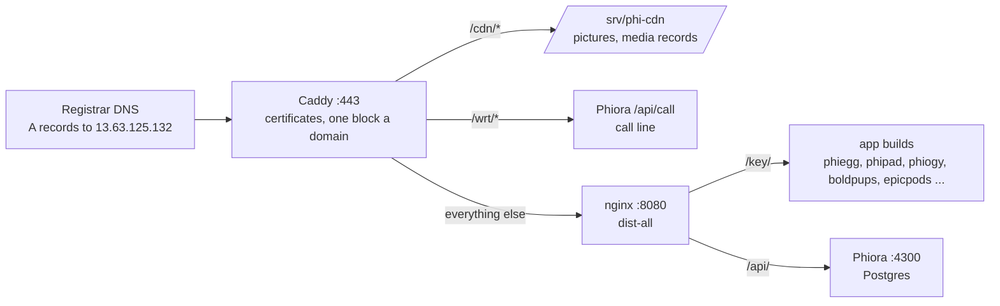

# Domains: what points where (27 November 2026)

Every domain is served by the one server, EC2 `13.63.125.132` (eu-north-1). Caddy on the host holds the
certificates and passes each request to nginx on `127.0.0.1:8080`, which serves every app's build at `/<key>/`
and Phiora at `/api/`. A domain is one Caddy site block that sends `/` to its app.
Nothing in this file has been changed on the server yet.



## 1. DNS records to enter at the registrar

Use TTL 300 while setting up, then raise it to 3600. There is no IPv6 address, so add no AAAA records.

The last column is what public DNS answered on 27 November 2026 (GoDaddy holds all of them).

| Domain | Type | Name (host) | Value | On 27 Nov |
|---|---|---|---|---|
| phipad.com | A | `@` | `13.63.125.132` | done |
| phipad.com | CNAME | `www` | `phipad.com.` | done |
| phiogy.com | A | `@` | `13.63.125.132` | done |
| phiogy.com | CNAME | `www` | `phiogy.com.` | done |
| phiecs.com | A | `@` | `13.63.125.132` | done |
| phiecs.com | CNAME | `www` | `phiecs.com.` | done |
| phiace.ai | A | `@` | `13.63.125.132` | done (live since 2026-11-02) |
| phiace.ai | CNAME | `www` | `phiace.ai.` | done |
| boldpups.xyz | A | `@` | `13.63.125.132` | done (GoDaddy's parked records gone, 2026-11-27) |
| boldpups.xyz | CNAME | `www` | `boldpups.xyz.` | done (follows the apex) |
| epicpods.xyz | A | `@` | `13.63.125.132` | done (the request said `.xyx`; the domain is `.xyz`) |
| epicpods.xyz | CNAME | `www` | `epicpods.xyz.` | done |
| phiegg.com | A | `cdn` | `13.63.125.132` | done |
| phiegg.com | A | `ora` | `13.63.125.132` | done (2026-11-27) |

Later on 27 November the user added phisum.com, cdn.phiogy.com and four city domains. Public DNS then answered:
phisum.com, cdn.phiogy.com, cdn.phiegg.com and bozo.city (each with `www`) point here, done. Later the same day
boldpups.xyz, once.city, wand.city and ora.phiegg.com did too, and went live. **To add:** acro.city (and `www`) has
no records; its block waits in `deploy/caddy/waiting.caddy`.

If the registrar cannot put a CNAME on `www`, use an A record to `13.63.125.132` there too.
Check each before touching Caddy: `nslookup boldpups.xyz` (or `dig +short boldpups.xyz`) must answer
`13.63.125.132`. Caddy asks Let's Encrypt for a certificate as soon as a block is loaded, and a name that does not
resolve yet counts against the failed-validation limit (5 an hour for each name).

Optional, once all resolve: a CAA record on each apex, `0 issue "letsencrypt.org"` and `0 issue "zerossl.com"`
(Caddy uses both), so no other authority can issue for these names.

## 2. Which app each address serves

| Address | Serves | Build at | State |
|---|---|---|---|
| phiegg.com | Phiegg (`/phiegg/`), web Phiogy (`/phiogy/`), `/cdn/`, `/wrt/` | `dist-all/phiegg` | live |
| phiace.ai | Phiace (`/phiace/`) | `dist-all/phiace` | live |
| phiber.ai | Phiber (`/phiber/`) | `dist-all/phiber` | live |
| phipad.com | Phipad (`/phipad/`); phipad.xyz then sends here | `dist-all/phipad` | live |
| phiogy.com | the landing page at `/` (config app `phiogy-home`, its registry `domain`), the web Phiogy at `/phiogy/`, with `/wrt/` and `/cdn/` so calls, pictures and the download stay on the same site | `dist-all/phiogy-home`, `dist-all/phiogy` | live |
| phiecs.com | no Phiecs page exists yet: sent to phiace.ai until one does (a config app like Bold Pups, one data file) | — | live (redirect) |
| boldpups.xyz | the Bold Pups site (`/boldpups/`), with `/cdn/` for the pictures | `dist-all/boldpups` | live |
| epicpods.xyz | the Epic Pods site (`/epicpods/`), with `/cdn/` | `dist-all/epicpods` | live |
| cdn.phiegg.com | `/srv/phi-cdn` at the root (the same files as phiegg.com/cdn) | — | live |
| ora.phiegg.com | Phiora's API at the root (`/app/phiegg` is `phiegg.com/api/app/phiegg`) | — | live |
| once.city, wand.city, bozo.city | their Bold City in Phiegg (`/phiegg/world/w_<name>_city`) | — | live |
| acro.city | its Bold City in Phiegg (`w_acro_city`) | — | waits for DNS |

## 3. Caddy site blocks to add

The whole file, with every block below and the new names, is `puikit/deploy/caddy/Caddyfile`: that file is what goes
to `/etc/caddy/Caddyfile`. It validated on the server's Caddy on 27 November (`Valid configuration`).

Two edits to `/etc/caddy/Caddyfile`. First, the inside of the `cdn` snippet becomes its own snippet (`cdn-files`),
so phiegg.com/cdn and cdn.phiegg.com share one set of cache rules. Caddy reads a snippet only if it comes before its
first use, so these two replace the `(cdn)` snippet where it is now, at the top:

```caddy
# Replaces the (cdn) snippet: the same rules, now shared by /cdn/ on any site and by cdn.phiegg.com.
(cdn-files) {
	root * /srv/phi-cdn
	@record {
		path *.json
		file
	}
	@picture {
		not path *.json *.zip
		file
	}
	@download {
		path *.zip
		file
	}
	header @record Cache-Control "public, max-age=300"
	header @picture Cache-Control "public, max-age=31536000"
	header @download Cache-Control "public, max-age=300"
	header Access-Control-Allow-Origin *
	file_server
}
(cdn) {
	handle_path /cdn/* {
		import cdn-files
	}
}
```

Second, these site blocks go after the existing ones:

```caddy
phipad.com {
	redir / /phipad/ 302
	import app
}
www.phipad.com {
	redir https://phipad.com{uri} 301
}
phiogy.com {
	# The landing is the root itself: the page finds its app by the domain (registry `domain`), not by a /<key>/.
	rewrite / /phiogy-home/
	import cdn
	import wrt
	import app
}
www.phiogy.com {
	redir https://phiogy.com{uri} 301
}
phiecs.com, www.phiecs.com {
	redir https://phiace.ai/phiace/ 302
}
boldpups.xyz {
	redir / /boldpups/ 302
	import cdn
	import app
}
www.boldpups.xyz {
	redir https://boldpups.xyz{uri} 301
}
epicpods.xyz {
	redir / /epicpods/ 302
	import cdn
	import app
}
www.epicpods.xyz {
	redir https://epicpods.xyz{uri} 301
}
cdn.phiegg.com {
	import cdn-files
}
ora.phiegg.com {
	encode gzip
	rewrite * /api{uri}
	reverse_proxy 127.0.0.1:8080 {
		flush_interval -1
	}
}
```

Once phipad.com answers, change the `phipad.xyz` block to `redir https://phipad.com{uri} 301` (and the same for
`www.phipad.xyz`), so the old address keeps its links.

On 2026-11-27 the server's Caddy checked these two edits applied to a copy of the live file (in `/tmp`, then removed)
and answered `Valid configuration`. The live Caddyfile was not changed.

### Applying it (only on the user's word)

1. `sudo cp /etc/caddy/Caddyfile /etc/caddy/Caddyfile.before-domains-$(date +%F-%H%M)`
2. Edit, then `sudo caddy fmt --overwrite /etc/caddy/Caddyfile` and
   `sudo caddy validate --config /etc/caddy/Caddyfile --adapter caddyfile`. Stop if it does not say `Valid configuration`.
3. `sudo systemctl restart caddy` at a quiet time, never `reload` (a reload panicked Caddy on 2026-11-25 while call
   streams were open). A restart drops open calls for a second.
4. At once: `curl -sI https://phiegg.com/phiegg/ https://phiace.ai/phiace/ https://boldpups.xyz/boldpups/ https://cdn.phiegg.com/manifest.json https://ora.phiegg.com/health`.
   If any old site fails, copy the backup back and restart.

### The two world sites on the server

Each is a config app of `app/phi`, built and sent as `DEPLOY.md` section 8 says, with its own key:

```sh
node scripts/world-site.mjs boldpups epicpods            # from puikit: writes app/<key>/public/data
cd app/phi
MSYS2_ENV_CONV_EXCL='PHI_BASE;VITE_PHI_API;VITE_PHI_MEDIA' PHI_BASE=/boldpups/ VITE_PHI_API=/api VITE_PHI_MEDIA=/cdn \
  npx vite build --outDir <out>/boldpups --emptyOutDir && cp -r ../boldpups/public/. <out>/boldpups/
```

Then add `location /boldpups/` and `location /epicpods/` rows to `dist-all/nginx.conf` (like `/phiogy/`) and
`docker compose restart web`. The pictures and the two world faces (`fonts/Boldland-Regular.woff2`,
`fonts/Graphigem-Regular.woff2`) are keys of the media store: send them and the new Bold Pups pictures with
`PHI_CDN_SSH=ubuntu@13.63.125.132 PHI_CDN_KEY=<key file> scripts/media/sync.sh server`. The server already has
`collections/hhoc` and `collections/bold-ape-epic-club` (the Epic Pods art) under `/srv/phi-cdn`.

## 4. What else is needed

- **The API on the same site.** Keep every app calling its own `/api` (all the app domains import `app`, which
  already proxies `/api/`). An app on boldpups.xyz calling ora.phiegg.com would be a cross-site request, and browsers
  drop the session cookie on those, so sign-in would not stick. ora.phiegg.com is for tools, scripts and the
  Phiora console. If any app is ever built against it, set `PHI_SECURE_COOKIES=1`.
- **Allowed origins.** If `.env` sets `PHI_ORIGINS`, add `https://phipad.com,https://phiogy.com,https://boldpups.xyz,https://epicpods.xyz`
  so email links and posts from the new sites are accepted. Then restart `phiora`.
- **Calls.** `wrt` stays on phiegg.com for the desktop Phiogy (`data/app.tsv`), and phiogy.com gets it too, so the
  web Phiogy can move there without a cross-site call line. coturn still needs UDP+TCP 3478 and UDP 49152-49407
  opened in the security group.
- **The CDN address.** Once cdn.phiegg.com answers, build Phiegg and the config apps with
  `VITE_PHI_MEDIA=https://cdn.phiegg.com`, which gives the pictures a cookie-free host of their own. phiegg.com/cdn
  keeps working for old links.
- **Email.** No domain sends mail yet (there is no Resend key, so account emails wait in an outbox). Pick one sending
  domain, `phiace.ai` or `phiegg.com`. Add it in Resend, which then shows three records to enter: a DKIM TXT record at
  `resend._domainkey`, and an MX and an SPF TXT record on a `send` subdomain. Put `RESEND_API_KEY` and
  `PHI_MAIL_FROM` (for example `hello@phiace.ai`) in `.env`. Receiving mail (hello@...) needs a forwarder's MX records
  (the registrar's forwarding, or a service such as ImprovMX).
- **Domains that never send mail.** Add these to each of them, so nobody can send mail in their name:
  TXT `@` `v=spf1 -all` and TXT `_dmarc` `v=DMARC1; p=reject;`. That covers phiogy.com, phiecs.com, boldpups.xyz,
  epicpods.xyz, and phipad.com unless it becomes the sending domain.
- **Old addresses.** `phipad.xyz` goes to phipad.com with a 301. `phiegg.com/phiogy/` stays (the desktop app's
  download page links there), and phiogy.com becomes the address to share.
- **Later.** `api.` and `wrt.` subdomains are not needed while each site proxies its own `/api` and `/wrt`.
  A scheduled Postgres backup (`pg_dump` to S3 nightly) is still missing and matters more than any new name.

## 5. phiogy.com: what to set so it takes calls and can be downloaded

Checked on 27 November 2026: phiogy.com and www.phiogy.com already answer `13.63.125.132`; coturn runs on the
server with the right public address (`external-ip=13.63.125.132/172.31.3.102`, ports 49152-49407, realm phiegg.com)
and `.env` already gives callers `turn:phiegg.com:3478` over UDP and TCP; the Windows build is on the server. A
connection test from outside to TCP 3478 failed, so the relay is not reachable yet.

**You (AWS console, EC2, the instance's security group, Inbound rules), add three rules, source `0.0.0.0/0`:**

| Type | Protocol | Port range | What for |
|---|---|---|---|
| Custom UDP | UDP | `3478` | the relay (TURN), for callers behind home routers and phone networks |
| Custom TCP | TCP | `3478` | the relay over TCP, for networks that block UDP |
| Custom UDP | UDP | `49152-49407` | the relayed sound and picture themselves |

Leave 22, 80 and 443 as they are. Without these, a call works only when both people are on networks that let
WebRTC through directly; with them, any two people can call.

**You (GoDaddy):** nothing more for phiogy.com. Optionally the no-mail records: TXT `@` `v=spf1 -all` and TXT `_dmarc`
`v=DMARC1; p=reject;`.

**Me, on your word, on the server:**
1. `.env`: add `https://phiogy.com` to `PHI_ORIGINS` (it is set), then `docker compose up -d phiora`.
2. Build the landing (`app/phiogy-home`) and the web Phiogy as config apps (`DEPLOY.md` section 8; the landing with
   `PHI_BASE=/phiogy-home/`), send both to `dist-all`, add `location /phiogy-home/` to `dist-all/nginx.conf`,
   `docker compose restart web`.
3. Send the landing's pictures (`media/phi-media/phiogy/shot/`) with `scripts/media/sync.sh server`.
4. The phiogy.com block in section 3 (root to the landing, `/cdn/`, `/wrt/`, the rest to nginx), validated on a copy
   first, then `systemctl restart caddy` at a quiet time.
5. Test: open phiogy.com, press Download for Windows, open the web Phiogy on two networks (one a phone hotspot) and
   call between them.

**Where the downloads are**

| Build | File on the server | Address | State |
|---|---|---|---|
| Windows (zip, `phiogy.exe`, nothing installed; Windows 10 or 11, DirectX 11) | `/srv/phi-cdn/phiogy/phiogy-windows.zip` (19 MB, 25 Nov) | `https://phiegg.com/cdn/phiogy/phiogy-windows.zip`, and `https://phiogy.com/cdn/phiogy/phiogy-windows.zip` once the block is in | live on phiegg.com |
| Mac | `/srv/phi-cdn/phiogy/phiogy-mac.zip` when there is one | `https://phiogy.com/cdn/phiogy/phiogy-mac.zip` | **not built**: it must be built on a Mac (`phikit/crates/appkit/app/phiogy/RUN.md`, macOS) and signed with an Apple Developer ID to open on other Macs. Until then the landing's Mac button opens the web Phiogy |

A new Windows build is copied over the same file (no script sends it yet: it went up by hand on 25 Nov); the `cdn` snippet caches zips
for 5 minutes, so people get it within minutes under the same link.

## 6. cdn.phiogy.com: content and sync, modelled on Discord's CDN

Read from Discord's developer docs (Reference: Image Formatting, CDN Endpoints, Signed Attachment CDN URLs,
Uploading Files; Message: the Attachment object), 27 November 2026. What Discord does, and the Phiogy version.
It follows the kind rule (a kind's name is its path) and `phikit/crates/appkit/app/phiogy/SHARED-LIBRARY.md`
section 4 (files kept once, by their hash).

| Discord | Phiogy (cdn.phiogy.com) |
|---|---|
| One CDN host, a path per resource: `avatars/<user>/<hash>.png`, `icons/<guild>/<hash>.png`, `emojis/<id>.png` | One host, a path per kind: `person/<id>/<hash>.webp`, `host/<id>/<hash>.webp`, `asset/<sha256>.<ext>` (the library's files; SHARED-LIBRARY calls the folder `lib/`, which should become `asset/` to match the kind) |
| The hash in the path changes when the picture changes, so a URL never goes stale and is cached for good | The same: a file's name is its sha256, so `Cache-Control: max-age=31536000` holds (the `cdn-files` rules already do this for pictures) |
| Format by extension; `?size=` any power of two, 16 to 4096 | Format by extension; sizes made once at upload as `<hash>-<size>.webp` for 64, 256 and 1024, since Caddy cannot resize. Ask for `?size=` later if an image service is added |
| Attachments `attachments/<channel>/<attachment>/<filename>`, signed with `ex` (expiry), `is` (issued) and `hm` (HMAC) | Room files `attachment/<room>/<id>/<filename>?ex=&is=&hm=`, signed by Phiora with a key in `.env`. Caddy checks each request with `forward_auth` against Phiora (`/api/file/check`) before serving the file, so a link from a private room stops working after its expiry |
| Public things (avatars, icons, emoji) are not signed and never expire | Public things (people's faces, hosts' marks, approved library assets, downloads) are plain paths |
| Upload: `multipart/form-data`, `files[n]` parts plus `payload_json` with `attachments: [{ id, filename, description }]`; 20 MiB a file by default, 25 MiB a request | `POST /file` to Phiora in the same shape: `files[n]` and `payload_json`; it stores each file under its hash, makes the sizes, and answers attachment records. Limits by role: 25 MB for members, more for the team's library |
| Attachment object: `id`, `filename`, `title`, `description` (alt text), `content_type`, `size`, `url`, `proxy_url`, `height`, `width`, `duration_secs`, `waveform`, `flags` | Kind `attachment` in Phiora's `items`, the same fields plus `hash`, `room` and `owner`; library files are kind `asset` with their `state` (draft, in review, approved) |
| Clients refresh expired attachment links on their own | Phiogy asks Phiora's change log (`/tree/change?after=<seq>`) for what is new, fetches a file only when opened, keeps it in a local cache by hash, and asks for a fresh signed link when one has expired |

**Built today:** the store (`/srv/phi-cdn`), its cache rules, and cdn.phiogy.com serving it (section 3's file:
`deploy/caddy/Caddyfile`). The Windows download is at `cdn.phiogy.com/phiogy/phiogy-windows.zip` once it is live.
**Not built:** `POST /file`, the sizes, signing and `/api/file/check`, the `attachment` and `asset` kinds, the change
log's `after=`, and the `lib/` to `asset/` rename.
