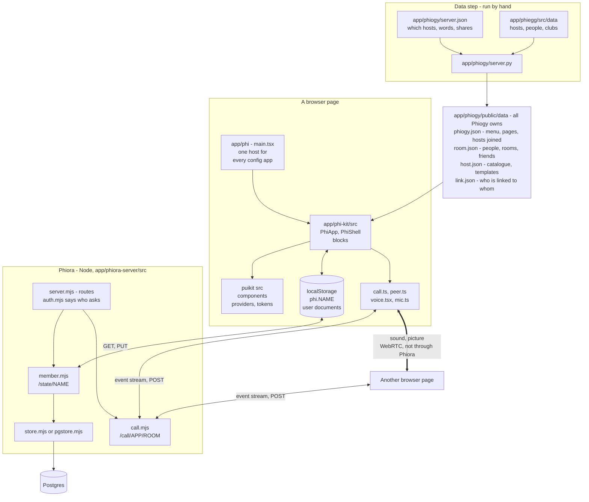
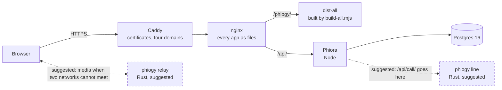
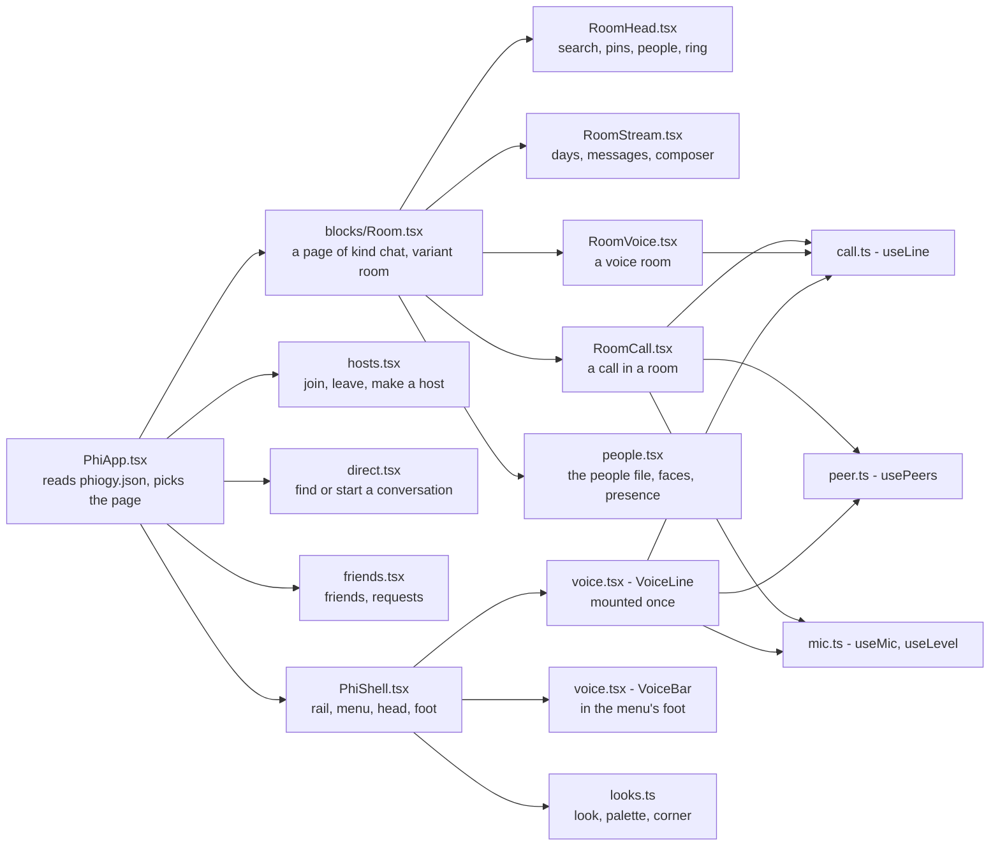
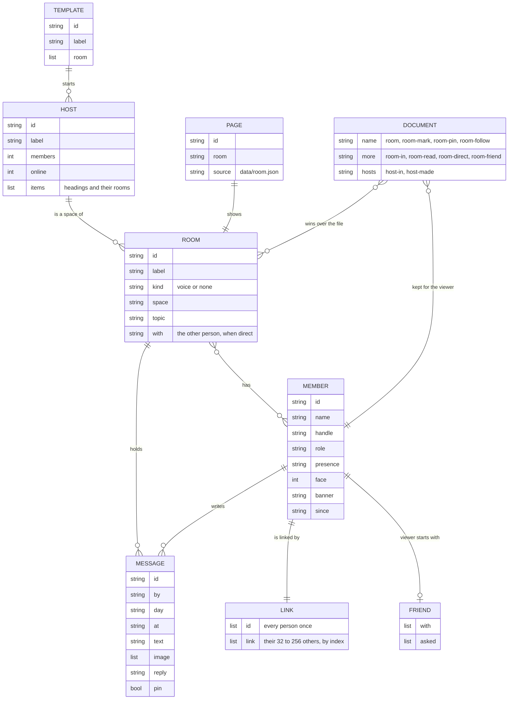
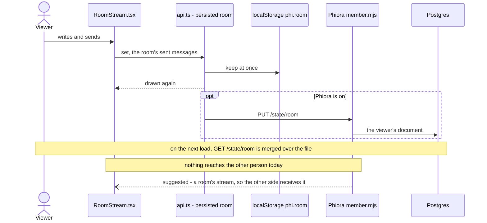
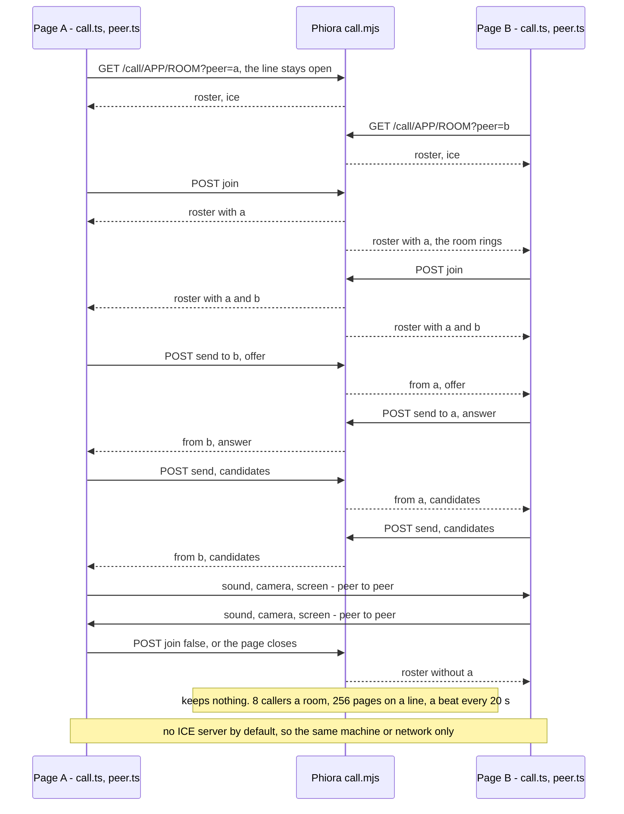
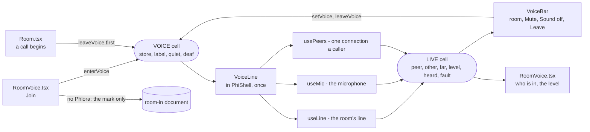
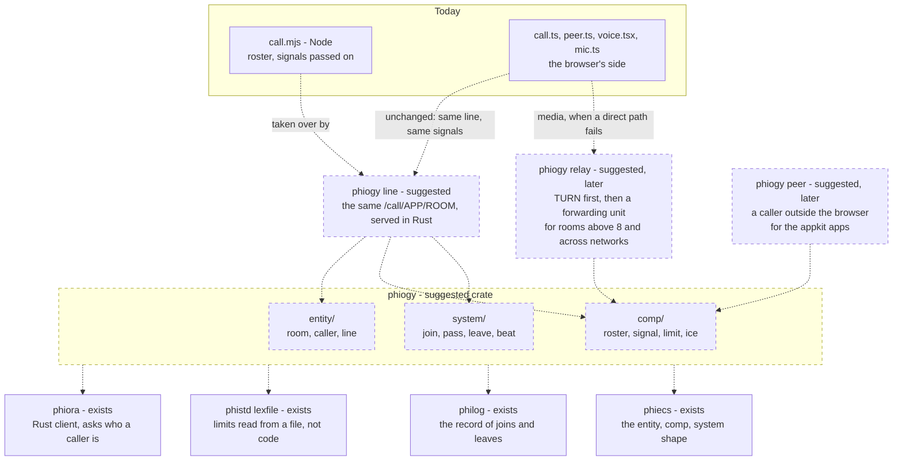
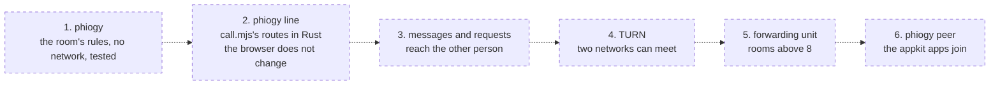

# Phiogy - architecture

Phiogy is the app that carries the calls. Solid boxes and lines exist today. Dashed boxes and lines are **suggested**,
not decided and not built. As of 2026-11-22 no Rust crate for Phiogy or for calls exists in the workspace (its place is settled, see the end): calls run
on the Node Phiora (`app/phiora-server/src/call.mjs`) and WebRTC in the browser (`app/phi-kit/src/peer.ts`).

## 1. The whole system

## 2. Where it runs

## 3. What a page is made of

## 4. The data

## 5. Writing a message, and every other thing the viewer does

## 6. A call

## 7. The voice session the shell holds

## 8. The Rust crates - suggested, none built

## 9. The order of work - suggested

Settled, 2026-11-22: Phiogy in Rust is an app on appkit, where Phigen is: `phikit/crates/appkit/app/phiogy`.
Open, for the user's word: which of the two `philog` crates keeps the record (phikit's is the session journal).
