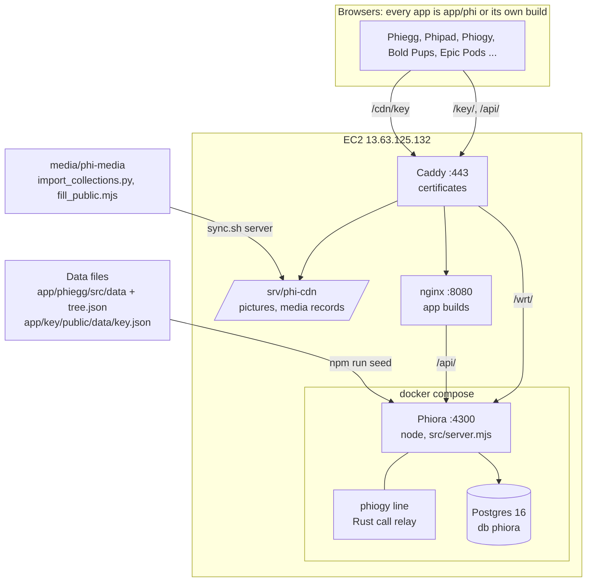

# Phiora: how it stands (27 November 2026)

Phiora is the one API and the one database behind every puikit app. Checked against the code in `src/` and the live
server (EC2 `13.63.125.132`, where `GET /api/tree/info` answered 34,911 records today). For the routes in detail, see
`README.md`.

## The pieces

| Piece | Where | What it does | State |
|---|---|---|---|
| Server | `src/server.mjs` | one HTTP server, singular routes (`/app`, `/item`, `/tree`), a guest session for every visitor | built, live |
| Items table | `items` (+ `item_meta`) in `src/store.mjs`, `src/pgstore.mjs` | every record of every kind once: `kind`, md5 `id`, `slug`, `ord`, the record as JSON. 47 kinds come from Phiegg's data files through `tree.json`; four more (`app`, `menu`, `page`, `block`) come from every app's data file | built, live (Postgres on the server, SQLite locally, JSON files as the last fallback) |
| Records | `src/records.mjs` | create, edit and delete one record: owners, the person a record names, editors (`PHI_EDITORS`); 32 KB and 80 fields a record; 30 changes a minute | built; `PHI_EDITORS` is empty on the server, so only owners edit |
| Change log | `item_changes` | every create, edit and delete: kind, id, action, fields, who, when. `GET /tree/change` reads it, and `GET /tree/item/<kind>/<id>` shows a record's last 20 | built |
| Seeding | `src/tree.mjs`, `src/apps.mjs`, `src/seed.mjs` | data files to records. A record edited through the API is kept, and a deleted one stays a tombstone so the next seed does not bring it back | built |
| Apps as records | `src/apps.mjs` | `GET /app/<key>` puts an app's document back together from its `app/menu/page/block` records, falling back to the file | built. Bold Pups and Epic Pods keep their 11,024 tokens in `data/token.json` (a block names it as `source`), so no block record is bigger than a few KB |
| Reading | `/tree`, `/tree?kind=&where=&limit=`, `/tree/rows`, `/menu` | all records, or one kind narrowed; pages of a kind sorted and joined | built |
| Accounts | `src/account.mjs`, `src/auth.mjs` | sign up, sign in, email confirm and reset, sessions, export, delete; JWT delegation for other services | built; emails wait in an outbox (no Resend key) |
| Money | `src/ledger.mjs`, `src/shop.mjs` | the server owns wallets: swap, spend, earn (capped), buy, offer, sell, with prices from the data files | built (in-system coins only, no card payments) |
| Calls | `src/call.mjs` + the `phiogy` line | who is in a room's call, and passing WebRTC signals between peers; nothing stored | built, live at phiegg.com/wrt |
| Chat | `src/model.mjs` | persona replies from an OpenAI-compatible or Anthropic model | built; no model set on the server, so replies are canned |
| Uploads | `media/phi-media` → `scripts/media/sync.sh server` → `/srv/phi-cdn` | pictures and media records, by key, from the media scripts on this machine; Caddy serves them at `/cdn/<key>` | built as a pipeline only. **Phiora has no upload route**: nobody can send a file from a page |

## Not built yet

- **Uploads from a page.** A `POST /upload` that takes a file from a signed-in person, writes it under a key in
  `/srv/phi-cdn` (later S3), and records it as an item with its owner.
- **Tokens as records.** The Bold Pups and Epic Pods tokens (kind `token`, see below) are files served beside each
  app, not yet records. Seeding them through `tree.json` would give each token an owner, a change log and
  `/tree/rows?kind=token&where=collection:boldpups`. The kit's `source` could then name that route instead of the file.
- **Backups.** The server has no scheduled `pg_dump`, and no crontab entry.
- **Email**, **a chat model** and **editors** (`RESEND_API_KEY`, `PHI_MODEL_*`, `PHI_EDITORS` in `.env`).
- **The Python engine.** `docker-compose.yml` also defines `phiadk` (the FastAPI engine over the same database,
  chosen with `build-all.mjs --backend python`). It does not run on the server; the node Phiora answers `/api/`.
- **ora.phiegg.com.** Phiora is reached at each site's `/api/` today. `app/DOMAINS.md` has the block that gives it
  its own address.

## Tests

`npm test` runs 75 tests. On this Windows machine 72 pass. The other three fail only when they try to delete their
temporary folder while SQLite still holds it open (`EPERM` in `rmSync`); what they check passes before that point.

## Kinds and their paths (audited 27 November 2026)

The rule: a kind has one name, and that name is every path to it.

| Where | Shape | Example |
|---|---|---|
| Phiora | `items.kind`, `/tree/item/<kind>/<id>`, `/tree/rows?kind=<kind>` | `token` |
| Data file | `<app>/…/data/<kind>.json`, an array of rows (singular file name) | `app/boldpups/public/data/token.json` |
| Seed and lookup | one `tree.json` row and one `source.json` entry: `{ kind, file: kind }` | `{ "kind": "token", "file": "token" }` |
| Address | `#/<kind>/<id>` (the record route every app has) | `#/token/boldpups-9570` |
| Picture | the media store's `<kind>/<id>.webp` | `cdn:token/boldpups-9570.webp` |
| Id | one of its kind across every app (prefixed by the app where rows from several apps meet) | `boldpups-9570` |

`token` follows the rule since this audit: Bold Pups and Epic Pods tokens are kind `token`, ids `<app>-<n>`, at
those paths. `scripts/world-site.mjs` hard-links each picture from where the importer put it
(`collections/<slug>/images/`) to `token/<id>.webp`. They are not seeded into Phiora yet.

Today only three of Phiora's 47 kinds match their file: `series`, `ride` and `jewel`. The rest sit in lists under
other names (`person` in `core.json` `users` and in `agents.json` `agents`; `room` in `messages.json` `voiceRooms`;
`profilePft` in `assets.json` `profiles`; `nest` in both `hosts.json` and `collections.json`) or in plural files
(`hosts.json`, `stores.json`, `pools.json`). Phiegg's lookup (`source.json`) and Phiora's seed (`tree.json`) also
disagree. `story`, `proposal`, `delegate` and `kindSpec` are seeded but cannot be looked up; `agent`, `brand`,
`brandShop`, `feedPost`, `pft`, `rental` and `shade` can be looked up but are never seeded. `profilePft` and `token`
are the same thing (a collection's token) under two names.

| Kind | Phiora seed (`tree.json`) | Phiegg lookup (`source.json`) | |
|---|---|---|---|
| `person` | core.json users; agents.json agents | core.users |  |
| `club` | core.json clubs | core.clubs |  |
| `world` | core.json worlds | core.worlds |  |
| `city` | core.json worlds.*.cities | core.worlds.*.cities |  |
| `host` | hosts.json hosts | hosts.hosts |  |
| `nest` | hosts.json nests; collections.json collections | hosts.nests |  |
| `show` | shows.json shows | shows.shows |  |
| `pose` | shows.json poses | shows.poses |  |
| `series` | series.json series | series.series | matches |
| `story` | stories.json stories | — |  |
| `quest` | economy.json quests | economy.quests |  |
| `coin` | economy.json coins | economy.coins |  |
| `liquidity` | economy.json liquidity | economy.liquidity |  |
| `event` | events.json events | events.events |  |
| `store` | stores.json stores; ls.json store | derived.store; stores.stores |  |
| `look` | stores.json stores.*.looks; ls.json looks | derived.store.*.looks |  |
| `pool` | stores.json stores.*.pools; ls.json pools; pools.json pools | pools.pools |  |
| `lot` | pools.json lots | pools.lots |  |
| `poolQuest` | pools.json quests | pools.quests |  |
| `metric` | pools.json metrics | pools.metrics |  |
| `piece` | club.json pieces | club.pieces |  |
| `role` | roles.json types | roles.types |  |
| `roleCategory` | roles.json categories | roles.categories |  |
| `egg` | assets.json eggs | assets.eggs |  |
| `sum` | assets.json sums | assets.sums |  |
| `profilePft` | assets.json profiles | assets.profiles |  |
| `ride` | ride.json list | ride.list | matches |
| `jewel` | jewel.json list | jewel.list | matches |
| `cast` | casts.json casts | casts.casts |  |
| `sale` | sales.json sales; trail.json sales | sales.sales |  |
| `shot` | feed.json shots | feed.shots |  |
| `post` | agents.json posts | agents.posts |  |
| `room` | messages.json voiceRooms | messages.voiceRooms |  |
| `conversation` | messages.json conversations | messages.conversations |  |
| `moment` | feed.json moments | feed.moments |  |
| `track` | phipad.json tracks | phipad.tracks |  |
| `application` | phipad.json applications | phipad.applications |  |
| `proposal` | dao.json proposals | — |  |
| `delegate` | dao.json delegates | — |  |
| `kindSpec` | kinds.json (map) | — |  |
| `agent` | — | agents.agents |  |
| `brand` | — | core.brands |  |
| `brandShop` | — | core.brands.*.shops |  |
| `feedPost` | — | derived.feedPost |  |
| `pft` | — | derived.pft |  |
| `rental` | — | derived.rental |  |
| `shade` | — | derived.shade |  |
| `token` | — (not seeded) | — | app/<key>/public/data/token.json, #/token/<id>, cdn token/<id>.webp |

**To bring every kind into line** (not started; it rewrites Phiegg's data files, which other sessions are editing):
1. One file a kind: `app/phiegg/src/data/<kind>.json` holding that kind's rows as an array. Rows found in two places
   (`person`, `store`, `look`, `pool`, `nest`, `sale`) are merged into the one file first.
2. `profilePft` becomes `token` (ids `phiegg-<n>` or the collection's own), so Phiegg and the world sites share one
   kind. `agent` becomes `person` rows with a role, or a kind of its own in `agent.json`, not both.
3. `tree.json` and `source.json` shrink to the list of kinds (the file is the kind), so they can no longer disagree.
4. The readers follow: Phiegg's `lib/data.ts`, the scripts that write data (`pools.mjs` and its 11 files),
   Phiogy's `room.json`/`host.json` (kinds `member`, `room`, `host`), and Phiora's seed.
5. Media keys move to `<kind>/<id>.<ext>` the same way (`worlds/…` to `world/<id>`, `collections/<slug>/images` to
   `token/<id>`), with Caddy's `/cdn/` serving both names until every link is moved.
