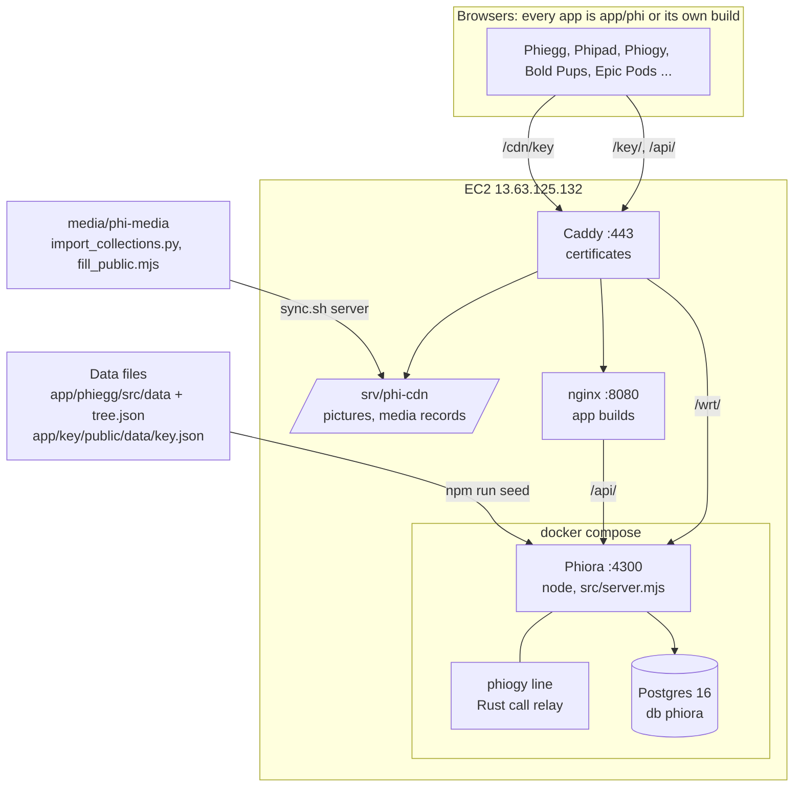

# Phiora: how it stands (27 November 2026)

Phiora is the one API and the one database behind every puikit app. Checked against the code in `src/` and the live
server (EC2 `13.63.125.132`, where `GET /api/tree/info` answered 34,911 records today). For the routes in detail, see
`README.md`.

## The pieces

| Piece | Where | What it does | State |
|---|---|---|---|
| Server | `src/server.mjs` | one HTTP server, singular routes (`/app`, `/item`, `/tree`), a guest session for every visitor | built, live |
| Items table | `items` (+ `item_meta`) in `src/store.mjs`, `src/pgstore.mjs` | every record of every kind once: `kind`, md5 `id`, `slug`, `ord`, the record as JSON. 47 kinds come from Phiegg's data files through `tree.json`; four more (`app`, `menu`, `page`, `block`) come from every app's data file | built, live (Postgres on the server, SQLite locally, JSON files as the last fallback) |
| Records | `src/records.mjs` | create, edit and delete one record: owners, the person a record names, editors (`PHI_EDITORS`); 32 KB and 80 fields a record; 30 changes a minute | built; `PHI_EDITORS` is empty on the server, so only owners edit |
| Change log | `item_changes` | every create, edit and delete: kind, id, action, fields, who, when. `GET /tree/change` reads it, and `GET /tree/item/<kind>/<id>` shows a record's last 20 | built |
| Seeding | `src/tree.mjs`, `src/apps.mjs`, `src/seed.mjs` | data files to records. A record edited through the API is kept, and a deleted one stays a tombstone so the next seed does not bring it back | built |
| Apps as records | `src/apps.mjs` | `GET /app/<key>` puts an app's document back together from its `app/menu/page/block` records, falling back to the file | built. Bold Pups and Epic Pods keep their 11,024 tokens in `data/token.json` (a block names it as `source`), so no block record is bigger than a few KB |
| Reading | `/tree`, `/tree?kind=&where=&limit=`, `/tree/rows`, `/menu` | all records, or one kind narrowed; pages of a kind sorted and joined | built |
| Accounts | `src/account.mjs`, `src/auth.mjs` | sign up, sign in, email confirm and reset, sessions, export, delete; JWT delegation for other services | built; emails wait in an outbox (no Resend key) |
| Money | `src/ledger.mjs`, `src/shop.mjs` | the server owns wallets: swap, spend, earn (capped), buy, offer, sell, with prices from the data files | built (in-system coins only, no card payments) |
| Calls | `src/call.mjs` + the `phiogy` line | who is in a room's call, and passing WebRTC signals between peers; nothing stored | built, live at phiegg.com/wrt |
| Chat | `src/model.mjs` | persona replies from an OpenAI-compatible or Anthropic model | built; no model set on the server, so replies are canned |
| Uploads | `media/phi-media` → `scripts/media/sync.sh server` → `/srv/phi-cdn` | pictures and media records, by key, from the media scripts on this machine; Caddy serves them at `/cdn/<key>` | built as a pipeline only. **Phiora has no upload route**: nobody can send a file from a page |

## Not built yet

- **Uploads from a page.** A `POST /upload` that takes a file from a signed-in person, writes it under a key in
  `/srv/phi-cdn` (later S3), and records it as an item with its owner.
- **Tokens as records.** The Bold Pups and Epic Pods tokens are files served beside each app, not records of kinds
  `pup` and `pod`. Seeding them as kinds through `tree.json` would give each token an owner, a change log and
  `/tree/rows?kind=pup&where=Club:HHOC`. The kit's `source` could then name that route instead of the file.
- **Backups.** The server has no scheduled `pg_dump`, and no crontab entry.
- **Email**, **a chat model** and **editors** (`RESEND_API_KEY`, `PHI_MODEL_*`, `PHI_EDITORS` in `.env`).
- **The Python engine.** `docker-compose.yml` also defines `phiadk` (the FastAPI engine over the same database,
  chosen with `build-all.mjs --backend python`). It does not run on the server; the node Phiora answers `/api/`.
- **ora.phiegg.com.** Phiora is reached at each site's `/api/` today. `app/DOMAINS.md` has the block that gives it
  its own address.

## Tests

`npm test` runs 75 tests. On this Windows machine 72 pass. The other three fail only when they try to delete their
temporary folder while SQLite still holds it open (`EPERM` in `rmSync`); what they check passes before that point.
