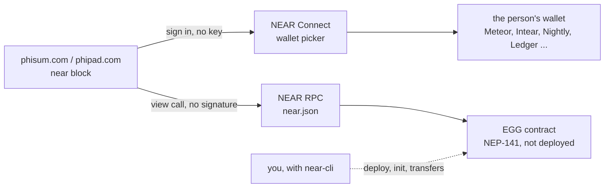

# EGG on NEAR: the plan (27 November 2026)

Phisum (phisum.com, the fund) and Phipad (phipad.com, the accelerator) both work with NEAR. This page says what is
wired, what EGG needs to become a NEAR token, and the steps that are yours to take. Nothing here has deployed a
contract, moved a token or made an account.

## 1. What is wired now

| Piece | Where | What it does |
|---|---|---|
| The `near` block | `app/phi-kit/src/module/near.tsx` | A "Connect a NEAR wallet" button; after sign-in, the account and its EGG balance. Any config app turns it on with `{ "kind": "near" }`. |
| Chain data | `app/phi-kit/src/near.json` | The network (testnet for now), each network's RPC and explorer, and EGG's contract id on each (empty). |
| Words | `app/phi-kit/src/words.json`, `near` | Every word the block shows. |
| The wallet package | `app/phi` (`@hot-labs/near-connect` 0.12.0, no dependencies) | The host registers the block (`app/phi/src/main.tsx`); apps with their own build never load it. |
| Pages | phisum `#/token`, phipad `#/near` | The block, with what connecting does. |
| Application form | phipad `#/apply` | An optional "NEAR account" field, so a team can say where EGG goes. |

Signing in asks for no access key (`signInWithoutAddKey`), so it costs the person nothing and sends no transaction.
The balance is read with a `call_function` view on the RPC, which needs no signature. Until `near.json` has a contract
id, the block says that EGG is not a NEAR token yet.

**Why NEAR Connect and not Wallet Selector:** NEAR archived `near/wallet-selector` on 10 November 2026 and its docs
now point to `@hot-labs/near-connect`. NEAR Connect loads its list of wallets from a manifest on GitHub
(`hot-dao/near-selector`) when the picker opens, and runs each wallet in a sandboxed frame. To pin that list, pass
your own `manifest` to the connector.

## 2. What EGG needs to be a NEAR token

EGG becomes a NEP-141 fungible token: one contract account holds the ledger. NEP-145 (storage) and NEP-148 (metadata)
come with it.

| Choice | Value | Why |
|---|---|---|
| Contract | `near-examples/FT` (near-sdk 5.x, near-contract-standards) | NEAR's reference token, with NEP-141, NEP-145 and NEP-148. |
| Account | `egg.<your-account>.near` (`egg.<your-account>.testnet` first) | A sub-account of yours, so it is plainly yours. |
| Name / symbol | `Egg` / `EGG` | |
| Decimals | 18 | 100T × 10^18 = 10^32 fits a u128 (max about 3.4 × 10^38) with room to spare. 24 decimals would leave only 3.4× headroom. |
| Total supply | `"100000000000000000000000000000000"` | 100,000,000,000,000 EGG in its smallest units, written as a string. |
| Icon | a `data:image/svg+xml;base64,...` URL of the EGG sign (`app/phiegg/public/logo/media/egg-sign-capital-e.svg`) | NEP-148 keeps the icon on chain, so keep it small. |
| Owner | your account | All 100T are minted to the owner at init; nothing is sent anywhere else. |

Cost: the contract's code and state are paid for by storage staking (1 NEAR per 100 kB, locked, not spent), so about
2 to 3 NEAR on the token account. Every account that is to hold EGG must first be registered with `storage_deposit`
(0.00125 NEAR, read the exact figure from `storage_balance_bounds`), and every `ft_transfer` attaches exactly
1 yoctoNEAR.

There is also NEAR's token factory (`token.primitives.near`, `get_required` then `create_token`), which deploys a
standard token without your own build. It is quicker; your own contract gives you the account name and full control.

## 3. Your steps (testnet first, then mainnet)

These need your keys and your NEAR, so they are yours. Check each command against the current near-cli-rs before you run it.

1. Install the tools: `npm i -g near-cli-rs@latest`, Rust, and `cargo install cargo-near`.
2. Log in on testnet with your own account (`near account import-account`), or make a testnet account in a wallet.
3. Make the token account: `near account create-account fund-myself egg.<you>.testnet '5 NEAR' autogenerate-new-keypair save-to-keychain sign-as <you>.testnet network-config testnet sign-with-keychain send`
4. Build the contract: clone `near-examples/FT` and run `cargo near build` in it.
5. Deploy and initialise it in one step:
   `near contract deploy egg.<you>.testnet use-file target/near/<wasm> with-init-call new json-args '{"owner_id":"<you>.testnet","total_supply":"100000000000000000000000000000000","metadata":{"spec":"ft-1.0.0","name":"Egg","symbol":"EGG","icon":"data:image/svg+xml;base64,...","decimals":18}}' prepaid-gas '100.0 Tgas' attached-deposit '0 NEAR' network-config testnet sign-with-keychain send`
6. Check it with view calls: `ft_metadata`, `ft_total_supply`, and `ft_balance_of {"account_id":"<you>.testnet"}`.
7. Put `egg.<you>.testnet` in `near.json` under `token.testnet`. The near block then shows a signed-in account's EGG.
8. When the terms are set and you are ready: repeat steps 3 to 6 on mainnet (`egg.<you>.near`, `network-config mainnet`),
   put it under `token.mainnet`, and set `"network": "mainnet"` in `near.json`.
9. Sending EGG to a team, under the cohort's terms: `storage_deposit {"account_id":"<team>.near"}` with 0.00125 NEAR,
   then `ft_transfer {"receiver_id":"<team>.near","amount":"<units>"}` with 1 yoctoNEAR. Releasing in stages can be done
   by hand at each stage, or later by a vesting contract.

Before mainnet: get advice on how EGG and the programme are offered where you and the teams are. The sites say EGG is
not an investment and promise no return; the terms are yours to write.

## 4. Later, when the sites need to know who someone is on NEAR

Signing in on the page proves nothing to a server. When Phiora needs to trust a NEAR account (to tie it to a Phiegg
account, or to record an allocation against it), use NEP-413:

1. Phiora issues a 32-byte nonce and remembers it.
2. The page asks the wallet to `signMessage({ message, recipient: "phisum.com", nonce })` (NEAR Connect's `signMessage`
   feature).
3. Phiora checks the ed25519 signature over the NEP-413 payload and that the public key is a full-access key of the
   account (RPC `view_access_key`), then spends the nonce. near-api-js has `verifyMessage` for the signature.

This is not built: it needs a Phiora endpoint and a decision about what a NEAR account is tied to.

## Sources

- https://github.com/near/wallet-selector (archived; points to NEAR Connect)
- https://docs.near.org/web3-apps/tutorials/wallet-login
- https://github.com/hot-dao/near-selector
- https://docs.near.org/primitives/ft/ft
- https://github.com/near-examples/FT
- https://github.com/near/NEPs/blob/master/neps/nep-0413.md
- https://docs.near.org/protocol/storage/storage-staking
- https://docs.near.org/api/rpc/providers
- https://docs.near.org/tools/near-cli
